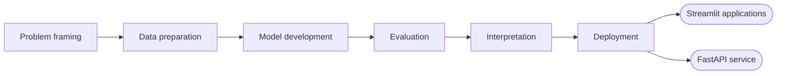
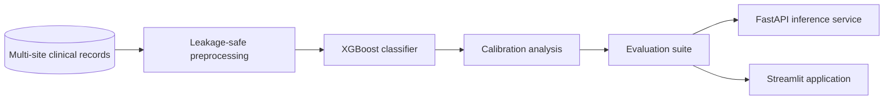

<a id="readme-top"></a>

<div align="center">


<br>

[](https://www.python.org/)
[](https://scikit-learn.org/)
[](https://xgboost.readthedocs.io/)
[](https://fastapi.tiangolo.com/)
[](https://streamlit.io/)

**[Live Demos](#live-demos)** &nbsp;·&nbsp; **[Projects](#projects)** &nbsp;·&nbsp; **[Featured Project](#featured-project)** &nbsp;·&nbsp; **[Tech Stack](#technology-stack)**

</div>

<br>

## Overview

This repository presents a curated collection of end-to-end machine-learning systems spanning clinical risk prediction, delivery-time forecasting, customer analytics, and natural-language classification.

Each project follows a complete development lifecycle: problem framing, data preparation, model development, evaluation, interpretation, and deployment. The work emphasizes leakage-safe validation, calibrated probabilistic outputs, robustness analysis, feature attribution, and production-oriented serving through APIs and interactive applications.

> [!NOTE]
> **Objective:** Build machine-learning systems that are measurable, interpretable, reproducible, and suitable for practical use.

<div align="center">

| Projects | Live demos | Inference APIs | Clinical records |
|:---:|:---:|:---:|:---:|
| **5** | **4** | **1** | **100,000** |

</div>

### Development lifecycle



<br>

## Live Demos

Interactive applications for exploring model inputs, predictions, and project workflows.

| Project | Stack | Demo |
|:---|:---|:---:|
| **Heart Disease Prediction** | XGBoost · Streamlit | [](https://machine-learning-portfolio-yvplwjtixokwsaowpeaawi.streamlit.app/) |
| **Delivery Time Predictor** | XGBoost · Streamlit | [](https://machine-learning-portfolio-yvplwjtixokwsaowpeaawi.streamlit.app/) |
| **Customer Churn Prediction** | scikit-learn · Streamlit | [](https://machine-learning-portfolio-yvplwjtixokwsaowpeaawi.streamlit.app/) |
| **Emotion Intelligence** | BiGRU · Streamlit | [](https://machine-learning-portfolio-ldcbeszryex4ncjmvpdesm.streamlit.app/) |

<p align="right"><a href="#readme-top">↑ Back to top</a></p>

## Projects

| Project | Domain | Approach and highlights | Demo |
|:---|:---|:---|:---:|
| [**Heart Disease Prediction**](heart_disease_prediction) | Clinical risk prediction | Leakage-safe XGBoost pipeline with calibration analysis, subgroup evaluation, permutation importance, and leave-one-site-out validation.<br>**Test ROC-AUC: 0.970** · FastAPI inference service | [Open](https://machine-learning-portfolio-yvplwjtixokwsaowpeaawi.streamlit.app/) |
| [**Delivery Time Predictor**](delivery-time-predictor) | Regression · Operations | Tuned XGBoost regressor supporting single and batch predictions, data insights, and model-performance analysis.<br>**Test MAE: 3.12 min** · **RMSE: 3.88 min** · **R²: 0.826** | [Open](https://machine-learning-portfolio-yvplwjtixokwsaowpeaawi.streamlit.app/) |
| [**Customer Churn Prediction**](customer-churn-prediction) | Customer analytics | Churn-prediction model with evaluation and a tabbed Streamlit interface for prediction, data insights, and model performance. | [Open](https://machine-learning-portfolio-yvplwjtixokwsaowpeaawi.streamlit.app/) |
| [**Emotion Intelligence**](emotion_Intelligence) | Natural language processing | Six-class emotion classifier built on a BiGRU sequence model and benchmarked against Simple RNN, LSTM, and GRU baselines.<br>**Test accuracy: 91.9%** | [Open](https://machine-learning-portfolio-ldcbeszryex4ncjmvpdesm.streamlit.app/) |
| [**Food Prediction**](Food-prediction) | Classification | Food-category prediction model. | — |

<p align="right"><a href="#readme-top">↑ Back to top</a></p>

## Featured Project

### Heart Disease Prediction

> [!WARNING]
> This project is intended for educational and portfolio purposes only. It is not a medical device and must not be used for clinical decision-making.

#### Problem statement

Cardiovascular risk models must generalize reliably across patient populations and clinical sites, rather than perform well only on an aggregate test set. This project develops a leakage-safe pipeline for heart-disease risk prediction using multi-site clinical records and evaluates its ability to generalize to unseen sites.

#### Pipeline



#### Dataset

| Attribute | Details |
|:---|:---|
| Size | 100,000 clinical records |
| Structure | Multi-site clinical dataset |
| Task | Binary heart-disease risk prediction |
| Validation strategy | Leave-one-site-out validation |

#### Modeling approach

The project uses an XGBoost classification pipeline trained on structured clinical features. Preprocessing and feature-selection decisions are made strictly within the training data, preventing information leakage from validation or test data into model development.

#### Results

<div align="center">

| Selected model | Test ROC-AUC | Test recall | Test specificity |
|:---:|:---:|:---:|:---:|
| **XGBoost** | **0.970** | **89.7%** | **92.2%** |

</div>

#### Evaluation methodology

Model performance is evaluated beyond aggregate accuracy:

| Technique | What it establishes |
|:---|:---|
| **Calibration analysis** | Whether predicted probabilities align with observed outcomes |
| **PR-AUC** | Precision–recall performance under class imbalance |
| **Bootstrap confidence intervals** | Uncertainty around reported performance metrics |
| **Subgroup analysis** | Model behavior across clinically relevant patient groups |
| **Permutation importance** | Relative contribution of input features to predictions |
| **Leave-one-site-out validation** | Generalization to unseen clinical sites and protection against site-specific overfitting |

<details>
<summary><b>Heart Disease API</b> — serve predictions over HTTP</summary>

<br>

The project includes a FastAPI service that exposes the trained model through a documented HTTP interface.

```bash
cd heart_disease_prediction
python -m pip install -r requirements.txt

# Start the API
python backend.py
```

Interactive API documentation is available at:

```text
http://127.0.0.1:8000/docs
```

</details>

<p align="right"><a href="#readme-top">↑ Back to top</a></p>

## Technology Stack

| Layer | Technologies |
|:---|:---|
| Machine learning | scikit-learn, XGBoost |
| Deep learning | BiGRU sequence models |
| Regression | Delivery-time prediction models |
| API serving | FastAPI |
| User interfaces | Streamlit |
| Model evaluation | Calibration, PR-AUC, bootstrap confidence intervals, permutation importance |
| Validation | Leave-one-site-out validation |

## Repository Structure

```text
machine-learning-portfolio/
├── assets/                       # README banner and media
├── heart_disease_prediction/     # Clinical risk model, FastAPI backend, Streamlit application
│   ├── backend.py
│   ├── app.py
│   └── requirements.txt
├── delivery-time-predictor/      # Delivery-time regression and Streamlit application
├── customer-churn-prediction/    # Customer churn model and Streamlit application
├── emotion_Intelligence/         # BiGRU emotion classifier and Streamlit application
├── Food-prediction/              # Food-category classifier
└── README.md
```

## Engineering Principles

| Principle | In practice |
|:---|:---|
| **End-to-end development** | Projects span data preparation, modeling, evaluation, interpretation, and deployment. |
| **Leakage-safe validation** | Workflows are designed to prevent information leakage and inflated performance estimates. |
| **Evaluation beyond accuracy** | Models are assessed on calibration, uncertainty, subgroup behavior, and feature attribution. |
| **Interactive deployment** | Models are served through Streamlit applications and, where applicable, FastAPI services. |
| **Reproducibility** | Dependencies, commands, and execution steps are documented for local reproduction. |

